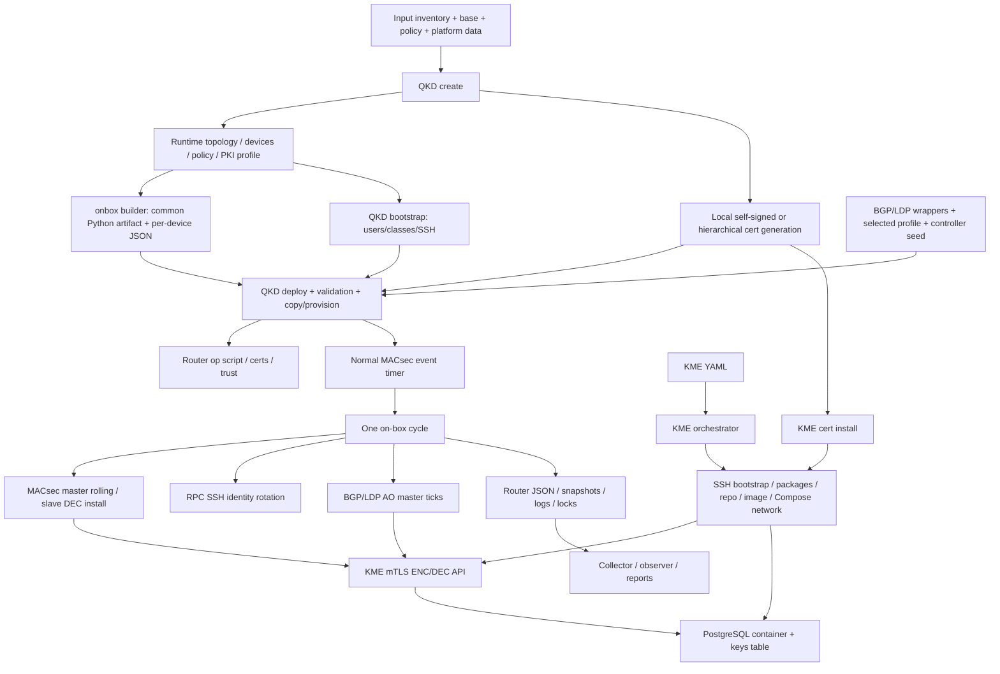

# Quantum-Safe-MACsec orchestration — implementation analysis

Static read-and-document analysis of the `unified-orchestrator` worktree. The documents describe implemented behavior, including destructive and incomplete paths, rather than presenting deployment instructions as verified production procedures. No router/Linux/network/container actions, CLI help, tests or project Python imports were executed. Only new Markdown documentation was created.

## Index

| Document | Coverage |
|---|---|
| [QKD lifecycle](qkd_orchestrator.md) | Every main QKD command/flag, credentials, runtime creation, router bootstrap/install/commit, validation and cleanup |
| [KME lifecycle](kme_orchestrator.md) | Public command/alias flow, standalone modules, Ubuntu/RHEL install, Compose/network/image/DB/certs/state |
| [BGP/LDP TCP-AO](tcp_ao_orchestrators.md) | Shared wrappers, every flag, discovery/profile/seed, router activation/rotation/checks and scheduling gap |
| [Router on-box program](onbox_script.md) | Builder/sidecars, op/event actions, identity/state/locks/keys, KME mTLS, master/slave/recovery |
| [PKI](pki.md) | Local generation modes, configuration actually honored, trust distribution, cert inspection and cleanup |
| [Operator tools](tools.md) | Every tool/flag/default, interactive inputs, collector/observer/report/health side effects |
| [Inventories and configuration](inventories.md) | All 42 checked-in config files, 1,519 YAML schema rows, template inputs, generated runtime contract and consumers |
| [Unified knob matrix](knob_matrix.md) | One consolidated table: 524 option/input/read-site rows; 267 explicit argparse CLI rows and 57 implicit help rows, plus environment/runtime/action/prompt inputs |
| [Gaps versus G1–G9](gaps_vs_goals.md) | What exists, partial coverage, missing implementation and operational risks per requested target |

## Entry points: what operators can actually launch

- `qkd_orchestrator.py`: create, bootstrap, deploy, clean, validate; **not** start/status/rotate/diagnose/stop. Source: `qkd_orchestrator.py:252`.
- `kme_orchestrator.py`: create, bootstrap, install-host, build-env, build-image, install-certs/cert-install, db-init, deploy, status, restart, validate, stop, destroy. Source: `kme_orchestrator.py:354`.
- `tcpao_orchestrator.py` and `ldp_orchestrator.py`: discover, preview, deploy, validate, status through shared CLI. Sources: `tcpao_orchestrator.py:1`, `ldp_orchestrator.py:1`, `lib/qkd/tcp_ao_cli.py:18`.
- Standalone module parsers include common script-user bootstrap, hierarchical PKI, log summary and KME implementation modules. The matrix distinguishes module CLI declarations from public wrapper subcommands. Sources: `lib/common/script_user_bootstrap.py:1349`, `lib/qkd/pki_hierarchical.py:880`, `lib/qkd/log_summary.py:27`, `lib/kme/build_env.py:466`.
- `artifacts/qkd_onbox.py`: copied to routers; event invocation runs one cycle, op actions handle peer installs/status/AO/RPC-public-key changes. Sources: `lib/qkd/onbox_builder.py:325`, `artifacts/qkd_onbox.py:7911`, `artifacts/qkd_onbox.py:8045`.
- Tools include configuration generators, optional full-sequence wrapper, cert analyzers, remote collectors/health polling and local reports. Source: `tools/customer_deploy.py:58`, `tools/generate_lab_config.py:313`, `tools/collect_device_logs.py:51`, `tools/cert_manager.py:444`.

## High-level call and data graph

Graph edges are grounded in create/artifact/PKI dispatch (`qkd_orchestrator.py:1165`, `qkd_orchestrator.py:1325`), deploy/provision (`qkd_orchestrator.py:1470`, `lib/qkd/provisioning.py:1121`), runtime cycle/API (`artifacts/qkd_onbox.py:7809`, `artifacts/qkd_onbox.py:5800`), KME create/Compose (`kme_orchestrator.py:105`, `lib/kme/compose.py:290`) and observer collection (`tools/observe_qkd_rotation.py:900`). AO-only deploy does not necessarily create the TIMER edge: `lib/qkd/provisioning.py:941`.

## Ordering model (dependency explanation, not commands executed)

1. Author/normalize source inventory and KME host config; keep credentials out of shared documentation. Runtime devices and cert naming derive from inventory. Sources: `tools/generate_lab_config.py:276`, `lib/qkd/topology_builder.py:316`.
2. QKD create generates runtime and PKI. It clears previous nonhidden runtime contents; do not treat as nondestructive inspect. Source: `qkd_orchestrator.py:1219`, `qkd_orchestrator.py:1325`.
3. Router SSH identity/bootstrap establishes required users/classes/trust. KME host SSH/bootstrap/dependencies/repo/image/Compose/certs/DB/deploy have their own state/order; KME install-certs requires step 2's PKI. Sources: `qkd_orchestrator.py:1377`, `kme_orchestrator.py:105`, `lib/kme/cert_install.py:229`.
4. Router deploy validates, uploads and commits. AO profiles target existing BGP/LDP sessions rather than create them. Preconditions include KME reachability and usable certificate trust at actual runtime. Sources: `qkd_orchestrator.py:1470`, `artifacts/qkd_onbox.py:1086`, `artifacts/qkd_onbox.py:1161`, `artifacts/qkd_onbox.py:5800`.
5. Junos timer invokes autonomous single cycles; observers inspect the resulting logs/state. Static controller commands are not a continuous controller service. Sources: `config/templates/common/event.j2:1`, `artifacts/qkd_onbox.py:8045`, `tools/observe_qkd_rotation.py:900`.
6. Cleanup needs deliberate scope selection; QKD remote clean, controller --pki and KME destroy have different retained/deleted resources and are not an atomic inverse. Sources: `lib/qkd/clean.py:85`, `lib/qkd/clean.py:382`, `lib/kme/destroy.py:13`.

The existing customer wrapper does not safely establish this fresh-lab order: its KME syntax and PKI dependency ordering are defective. Sources: `tools/customer_deploy.py:58`, `kme_orchestrator.py:354`, `lib/kme/cert_install.py:229`.

## Ten findings to read before operating

1. Predeploy validation deletes runtime logs/state/locks; full validation includes it. `lib/qkd/identity.py:499`, `lib/qkd/identity.py:1095`.
2. On-box status reconciles/promotes/persists; it is not passive diagnostics. `artifacts/qkd_onbox.py:6654`, `artifacts/qkd_onbox.py:6815`.
3. Clean deletes entire event-options; full-macsec deletes entire MACsec and authentication-keychain trees. `lib/qkd/clean.py:382`, `lib/qkd/clean.py:398`.
4. Create resets runtime before all later validation/builds. `qkd_orchestrator.py:1219`.
5. Provisioning exceptions can be warning-only, so a returned deploy is not proof every router commit succeeded. `lib/qkd/provisioning.py:1299`.
6. Customer wrapper has KME option-order and fresh PKI-order defects. `tools/customer_deploy.py:58`, `kme_orchestrator.py:354`.
7. AO-only setup omits periodic timer installation; initial authenticated session is not proof future rotation is scheduled. `lib/qkd/provisioning.py:941`, `artifacts/qkd_onbox.py:7866`.
8. KME count default 2 can disagree with runtime-derived checks/PKI unique-IP count. `kme_orchestrator.py:331`, `lib/kme/compose.py:109`, `lib/qkd/pki_self_signed.py:246`.
9. DB --content-type BYTEA does not change the literal TEXT schema; readiness can wait forever. `lib/kme/db_init.py:12`, `lib/kme/db_init.py:164`, `lib/kme/db_init.py:203`.
10. Several declared safety/policy/config fields are inert; generic license gating, Kubernetes, SRX IPsec and Junos EVO-native KME lifecycle are not supplied by filenames or comments. `lib/qkd/pki_hierarchical.py:793`, `lib/qkd/inventory_builder.py:469`, `lib/qkd/provisioning.py:329`, `config/kme/lab_evo.yaml:1`, `config/inventory/platforms/srx.yaml:1`.

## Evidence and uncertainty

Citations are repository-relative `path:line` references to declarations, helpers or ordered code blocks. A citation to a block's opening line covers its described flow; exact scalar configuration lines appear in the inventory catalog. Matrix defaults retain Python expressions when their values are runtime-derived; catalogs distinguish checked-in selections from code fallbacks.

Not established without prohibited live execution: router/platform/license availability, actual commit success, KME upstream key ingestion/synchronization behavior, container image compatibility, network/TLS reachability, deployed state contents and recovery under real failure. The current worktree has no generated config/runtime directory; generated schemas are documented from writers, not fabricated runtime files. Sources for those contracts: `lib/qkd/inventory_builder.py:506`, `lib/qkd/onbox_builder.py:354`.
